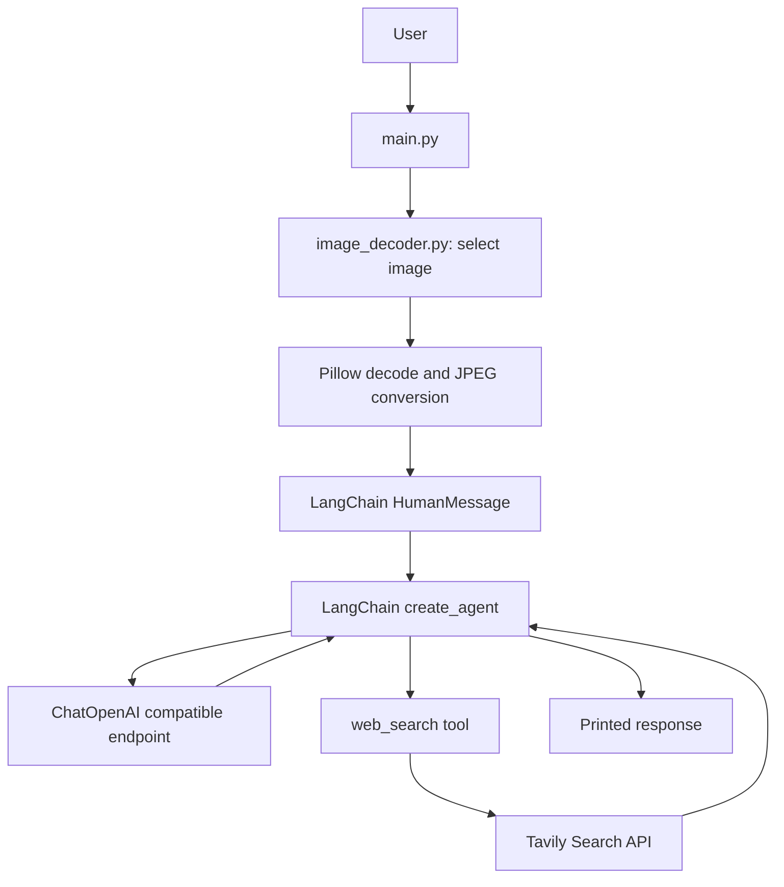

# WhatToCook-AI Project Guide

This guide consolidates architecture, implementation, setup, testing, and maintenance notes for the current small CLI prototype. It documents the repository as implemented; items marked “not identified” are not present in the inspected code.

## Purpose and scope

WhatToCook-AI explores using a food image to identify ingredients and find a recipe that can use them. The implemented interface is a developer-run Python command-line script. No hosted service or consumer application is identified.

The application selects a local image, normalizes it to JPEG, asks a configured chat model to analyze it, and gives a LangChain agent a Tavily search tool for recipe discovery. Recipe accuracy depends on external services and model output.

## Features

- Image selection using a desktop file picker, with a console path fallback.
- Image decoding and conversion to RGB JPEG using Pillow.
- Multimodal model requests through `ChatOpenAI`.
- Tavily recipe search exposed as an agent tool.
- Direct vision diagnostic through `test_vision.py`.

There is no database, application-owned HTTP API, frontend, user accounts, authentication, authorization, or automated test suite.

## Architecture



`main.py` selects an image, creates a message using `chef_prompt`, invokes the agent, and prints the last response. The agent combines a chat model, system instructions, and Tavily tool. The image is processed in memory; code does not persist images, search results, or conversations.

### Components

| File | Responsibility |
| --- | --- |
| `main.py` | Interactive recipe workflow and response output |
| `agent/image_decoder.py` | Select/decode/normalize image and build multimodal message |
| `agent/models.py` | Configure `ChatOpenAI` from environment |
| `agent/agent.py` | Compose model, tool, and system prompt with LangChain |
| `agent/tools.py` | Wrap Tavily search as a LangChain tool |
| `agent/system_prompt.py` | Agent instructions and user prompt |
| `test_vision.py` | Manual direct model diagnostic; does not use agent or Tavily |
| `src/whattocook_ai/__init__.py` | Scaffold package function that prints a greeting |
| `pyproject.toml` | Project metadata, dependencies, and console script declaration |
| `uv.lock` | Locked dependency resolution |
| `.env.example` | Placeholder environment configuration |

`agent/__inti__.py` is misspelled and empty; imports currently rely on Python namespace-package behavior. The project uses Python 3.12+ and declares `langchain`, `langchain-openai`, `tavily`, `python-dotenv` (declared as `dotenv`), and Pillow. No frontend, web framework, database library, or authentication package is declared.

## Setup and configuration

### Prerequisites

- Python 3.12 or newer.
- `uv` (the repository contains `uv.lock` and uses `uv_build`).
- A multimodal chat model endpoint compatible with `langchain-openai`.
- Tavily API credentials for recipe search.
- Tk support and a graphical display for the image picker; otherwise enter an image path at the prompt.

### Install and run

```bash
git clone <repository-url>
cd WhatToCook-AI
uv sync
cp .env.example .env
```

Set the variables below in `.env`, then run the current application entry script:

```bash
uv run python main.py
```

Direct model diagnostic:

```bash
uv run python test_vision.py /absolute/path/to/image.jpg
```

### Environment variables

| Variable | Required | Purpose |
| --- | --- | --- |
| `MODEL` | Yes | Model identifier passed to `ChatOpenAI` |
| `OPENAI_API_KEY` | Yes | Credential passed to the model client; provider semantics may vary |
| `BASE_URL` | Provider-dependent | Optional custom OpenAI-compatible base URL |
| `TAVILY_API_KEY` | For search | Credential used by `TavilyClient` |

`.env.example` contains placeholders. Do not commit real secrets. Runtime environment variables can also supply configuration. Separate development, staging, and production profiles are not implemented.

### Image handling

The decoder verifies that the path is a file, uses Pillow to decode it, converts it to RGB JPEG in memory, and embeds the base64 data URL in a LangChain message. The picker advertises PNG, JPEG, and WebP; additional formats depend on the local Pillow build. Corrupt or unsupported images fail locally before the model call.

## Application behavior and workflows

### Recipe recommendation

1. `main.py` opens the picker or requests a path if Tk raises `TclError`.
2. `build_image_message` converts the image and combines it with `chef_prompt`.
3. The LangChain agent receives the message under the system instructions.
4. The agent may call Tavily search with an ingredient-based query.
5. Search results return to the agent, which produces a response printed to stdout.

The prompt requests ingredient identification, recipe selection, match percentage, cooking details, and missing ingredients. These are generated by the model; the application does not calculate or independently verify them.

### Vision diagnostic

`test_vision.py` accepts an optional path argument, otherwise uses the image picker. It directly invokes the configured model with an ingredient-identification prompt. It does not invoke the agent or search tool. This script makes a live request and may incur service usage charges; it is not an automated test.

## API and database

No application-owned HTTP endpoints, routes, request/response schemas, or database schema are present. The app is a local CLI. External service calls are delegated to `langchain-openai` and Tavily libraries; provider-specific URLs, headers, and schemas depend on configuration and are not defined by this repository.

No database driver, ORM, migrations, tables, or persistence layer is identified. Database backups and migrations are not applicable to the current implementation.

## Errors, logging, and security

- Image file and decode failures are raised locally by `image_decoder.py`.
- The diagnostic catches exceptions around the model call and prints them; image selection/message construction occur before that handler.
- `web_search` catches Tavily exceptions and returns an error dictionary.
- `main.py` enables `langchain.debug = True`; no structured logging, monitoring, or centralized error handling is configured.
- Credentials are passed to third-party clients. No application authentication, authorization, rate limiting, or secret-redaction layer is implemented.
- `.gitignore` excludes `.env` and credential-like files. Do not publish secret values or sensitive exception payloads.

## Testing and verification

No unit, integration, or end-to-end framework, test directory, or coverage configuration is identified. `test_vision.py` is a manual live-service diagnostic.

Suggested manual checks:

- Confirm required configuration is present without printing secret values.
- Try valid JPEG, PNG, and WebP files against a vision-capable endpoint.
- Try a missing path and a corrupt/unsupported image.
- Run `uv run python main.py` and verify search and final response behavior.
- Check missing credentials and Tavily failure behavior.

No formatter, linter, or automated test command is configured in project metadata.

## Build and deployment

`pyproject.toml` declares the `uv_build` backend. Build with:

```bash
uv build
```

No container, deployment manifest, CI/CD workflow, hosting requirements, production configuration, health check, or rollback procedure is present. Production deployment is not identified. No persistent application data exists to back up.

## Troubleshooting

| Symptom | Likely cause and action |
| --- | --- |
| `Failed to load image or audio file` (HTTP 400) | Confirm the model endpoint supports vision and the image is decodable. The application converts images to JPEG; check provider-specific multimodal compatibility. |
| `Image not found` | Check the path and read permissions; try an absolute path. |
| `Could not decode image file` | Re-export as PNG or JPEG and retry. |
| File dialog unavailable | Use the console fallback or pass a path to `test_vision.py`. |
| Model connection/authentication error | Check `MODEL`, `OPENAI_API_KEY`, `BASE_URL`, and provider compatibility without exposing credentials. |
| Tavily search/authentication error | Check `TAVILY_API_KEY` and service availability. |
| Dependency/import error | Run `uv sync` and commands through `uv run` from the project root. |
| Installed `whattocook-ai` command prints a greeting | The console script targets `whattocook_ai:main` in the scaffold package, not the recipe workflow; run `uv run python main.py`. |

## Contribution notes and limitations

Keep changes in the module responsible for the behavior: image preparation in `agent/image_decoder.py`, model configuration in `agent/models.py`, search integration in `agent/tools.py`, and instructions in `agent/system_prompt.py`. Keep credentials out of commits. Branching, commit message, formatting, review, and release conventions are not identified.

Verified limitations include no persistence, HTTP API, account system, automated tests, production deployment configuration, independent fact-checking of model output, or explicit provider timeout/retry configuration. Possible future improvements include automated tests with mocked external services, CLI argument parsing, fixing the package console entry point, and structured logging; these are recommendations, not implemented features.
